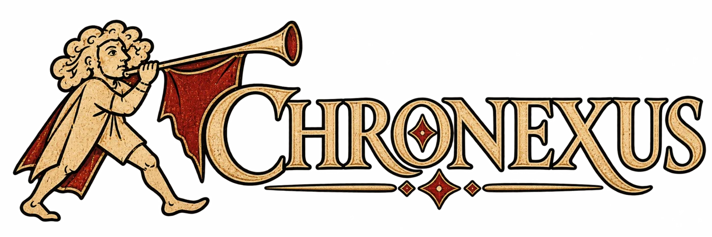
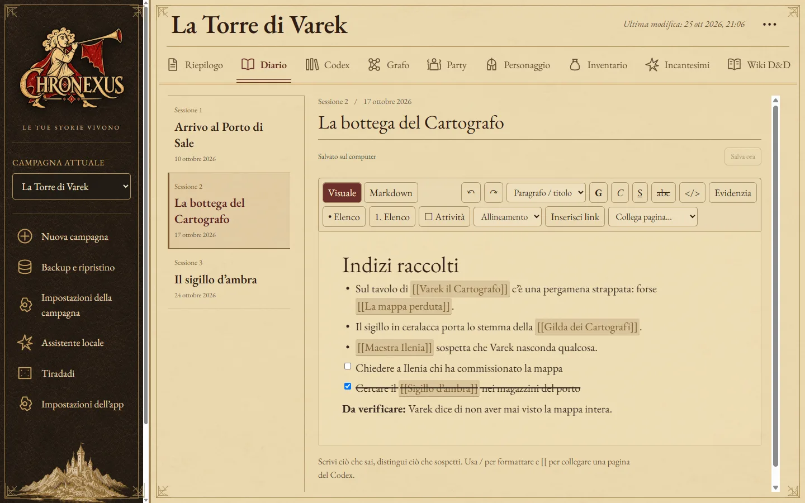
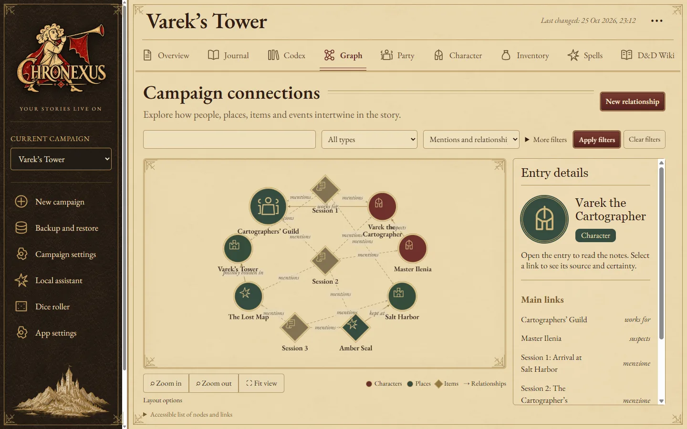
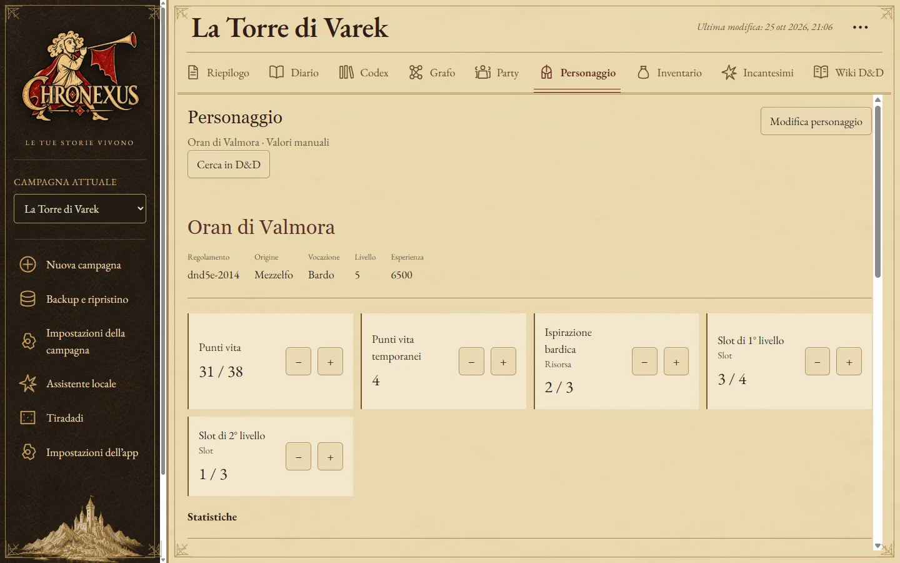
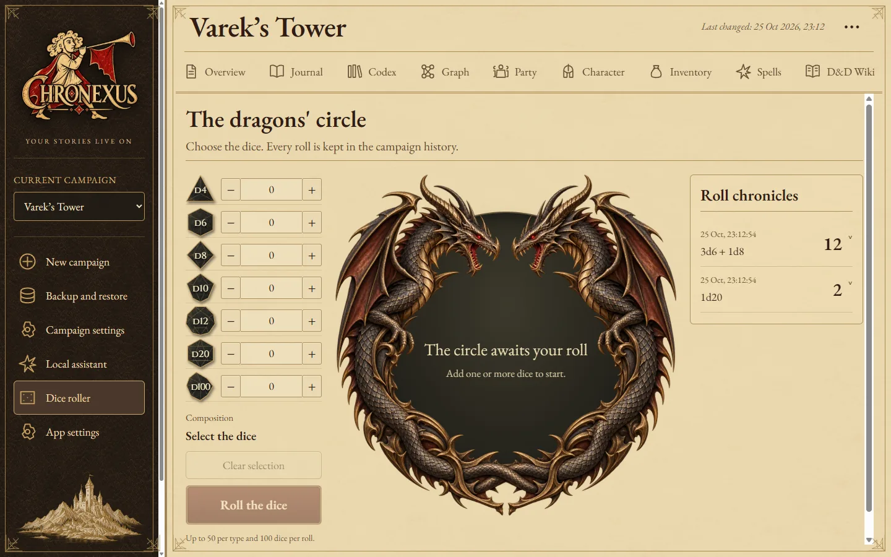
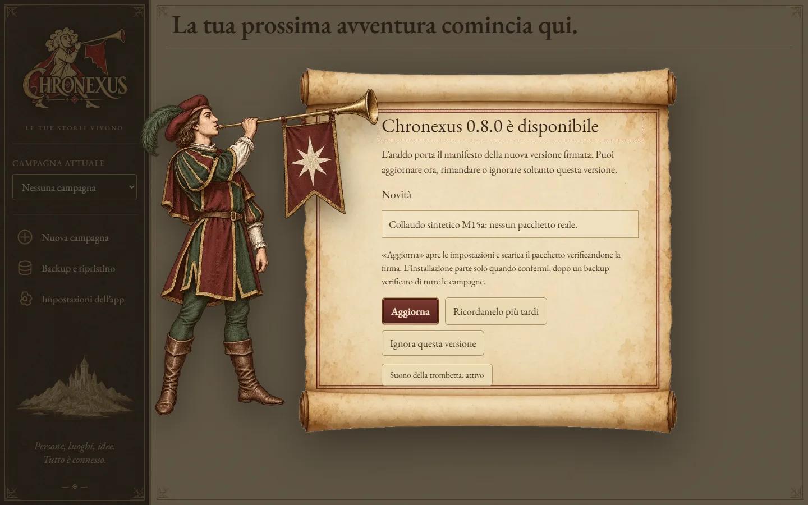

**Il diario del giocatore di ruolo: offline, privato, tutto collegato.**

Annota le sessioni, tieni la scheda del personaggio e ritrova chi ti ha dato quella chiave,
in quale sessione e per quale fazione, senza account e senza cloud.

[Scarica](#download-e-installazione) · [Funzionalità](#funzionalità) · [Guida](docs/GUIDE.md) · [Roadmap](ROADMAP.md) · [English](README.md)

> [!IMPORTANT]
> **Chronexus è interamente vibecoded.** Codice, test e documentazione sono stati scritti
> da agenti di programmazione AI (OpenAI Codex e Claude Code) seguendo le mie istruzioni,
> non a mano. L’ho realizzato solo per un bisogno personale, da giocatore che voleva
> questo strumento, e per curiosità di vedere fin dove gli agenti AI possono spingersi
> nello sviluppo di un software vero. Non c’è un’azienda né uno scopo commerciale. Se
> preferisci evitare software generato con l’AI, consideralo un avviso onesto.
> L’assistente integrato è una funzione separata e facoltativa: è disattivato di
> predefinito e l’app funziona completamente senza.

## Cos’è Chronexus

Chronexus è un’applicazione desktop per chi **gioca** una campagna di ruolo, non
per chi la dirige. Raccoglie in un solo archivio locale il diario delle sessioni, le
pagine su personaggi, luoghi e fazioni, la scheda del personaggio, l’inventario e
gli incantesimi, e collega tutto con riferimenti stabili.

## Perché Chronexus

- **Dalla parte del giocatore.** Ciò che il tuo personaggio sa, sospetta o ha
  sentito dire: niente segreti del master, niente fatti inventati.
- **Una menzione non è un fatto.** Citare due personaggi nella stessa nota non li
  rende alleati: le relazioni le dichiari tu, con fonte e certezza
  (confermata, sospetta, smentita, sconosciuta).
- **I tuoi dati restano tuoi.** Database locale, backup completi in un file
  `.nodex`, nessun account, nessuna telemetria.
- **Pensato per giocare.** Salvataggio automatico, scorciatoie da tastiera, tiradadi
  e scheda a portata di clic durante la sessione.

## Funzionalità

| | Funzione | In breve |
| --- | --- | --- |
|  | **Diario delle sessioni** | Editor visuale e Markdown, salvataggio automatico, menzioni `[[Nome]]` con collegamenti che sopravvivono alle rinomine |
|  | **Codex** | Pagine per PNG, luoghi, fazioni, missioni e oggetti, con alias, immagini e collegamenti in entrata |
|  | **Grafo delle conoscenze** | Menzioni e relazioni dichiarate distinte, filtri per tipo, certezza e sessione, ritorno alla fonte |
|  | **Scheda, inventario e capacità** | Scheda manuale generica o D&D 5e 2014, provenienza degli oggetti, incantesimi e slot senza formule nascoste |
|  | **Tiradadi** | d4–d100 combinati, storico per campagna, cerchio dei draghi animato e movimento ridotto |
|  | **Ricerca** | Testo completo su note, pagine, scheda e oggetti con apertura del blocco trovato (Ctrl/⌘ + K) |
|  | **Wiki D&D** | Wikidot o Open5e su richiesta, copie offline, traduzione locale nella lingua dell’app |
|  | **Assistente locale (facoltativo)** | Domande sugli appunti con citazioni, su GPU e senza cloud, con Qwen3.8-27B o Gemma 4 12B |
|  | **Lingue e scritture** | 11 lingue, arabo da destra a sinistra, Braille, Morse, Espruar, Dethek e altre scritture |
|  | **Aggiornamenti firmati** | Controllo, download verificato e backup obbligatorio prima di installare, annunciati dall’araldo |

<strong>Altre schermate</strong>

Schermate da una campagna d’esempio inventata; l’annuncio mostra una versione d’esempio.

## Download e installazione

| Metodo | Per chi | Come |
| --- | --- | --- |
| **Installer Windows x64** | Tutti | Scarica `Chronexus_<versione>_x64-setup.exe` dall’[ultima release](https://github.com/Acelith/Chronexus/releases) ed eseguilo |
| **Aggiornamento dall’app** | Chi ha già la 0.4.0 o successiva | Impostazioni dell’app → Aggiornamenti dell’app |
| **Dal sorgente** | Sviluppatori | Vedi [docs/DEVELOPMENT.md](docs/DEVELOPMENT.md) |

**Requisiti:** Windows 10/11 x64 con WebView2 (già presente nelle versioni recenti).
Per l’assistente facoltativo serve una GPU NVIDIA; da **Impostazioni dell’app → AI
locale: componenti** puoi installare Ollama e il modello senza usare il terminale.

**Primo avvio:** crea una campagna, apri una sessione e scrivi. Digita `[[` per
collegare un personaggio o un luogo, poi esplora **Codex** e **Grafo**.

> [!WARNING]
> L’installer non ha una firma Authenticode di Windows: SmartScreen può chiedere
> conferma. Gli aggiornamenti dall’app sono comunque verificati con una firma
> crittografica dedicata. macOS e Linux non sono ancora verificati.

## Aggiornamenti e backup

- **Backup e ripristino** crea un file `.nodex` con tutte le campagne e le
  immagini, verificato con SHA-256; il ripristino mostra un’anteprima e conserva
  una copia di sicurezza dei dati attuali.
- **Backup periodici** (Impostazioni dell’app → Backup, disattivati finché non li
  attivi): ogni giorno, ogni settimana o ogni N ore, solo con l’app aperta e
  inattiva, nella cartella `Documenti/Chronexus/Backup periodici` o in una cartella
  scelta da te. Chronexus conserva il numero di copie indicato ed elimina solo le
  copie periodiche che ha creato e registrato.
- Prima di ogni aggiornamento Chronexus crea e verifica un backup completo in
  `Documenti/Chronexus/Backup aggiornamenti` (o nella cartella dati, con avviso, se i
  Documenti non sono utilizzabili): se non riesce, l’installazione si ferma.
- L’araldo annuncia le nuove versioni dopo un controllo leggero all’avvio, che puoi
  disattivare. L’installazione parte solo quando la confermi.

> [!IMPORTANT]
> I backup `.nodex` non sono cifrati. Conservali in un posto sicuro, soprattutto se
> la cartella è sincronizzata con un servizio cloud.

## Assistente locale

Facoltativo e disattivato finché non lo abiliti per una campagna. Risponde in
italiano usando solo gli appunti della campagna e le voci della wiki che approvi,
con citazioni riapribili. Funziona sulla GPU tramite Ollama con il cloud
disattivato e non modifica mai appunti, relazioni o scheda.

> [!NOTE]
> Qwen3.8-27B e Gemma 4 12B sono modelli multilingue, **non** addestrati
> specificamente su D&D: una citazione valida non garantisce che la risposta sia
> corretta. Dettagli in [docs/AI_MODELS.md](docs/AI_MODELS.md).

## Privacy e dati

- Nessun account, nessuna telemetria, nessun caricamento delle campagne.
- Le uniche richieste di rete partono da un tuo clic (wiki, catalogo SRD,
  aggiornamenti, componenti AI) oppure dal controllo aggiornamenti all’avvio, che
  contatta solo il canale delle release e si può disattivare.
- Le richieste alle wiki contengono solo il termine o la pagina che cerchi.

## Lingue

Italiano (originale), inglese, tedesco, francese, spagnolo, portoghese brasiliano,
giapponese, coreano, cinese semplificato e arabo, più scritture alternative. Le traduzioni sono bozze da revisionare: vedi
[docs/I18N.md](docs/I18N.md). Appunti e fonti non vengono mai tradotti in automatico.

## Roadmap

Le milestone consegnate, quelle aperte e i limiti ancora da verificare sono in
[ROADMAP.md](ROADMAP.md); lo stato dettagliato e le prove eseguite in
[docs/STATUS.md](docs/STATUS.md).

## Sviluppo e contributi

Chronexus è scritto con Tauri 2, Rust, React e TypeScript, con SQLite locale.
Prerequisiti, comandi e verifiche sono in [docs/DEVELOPMENT.md](docs/DEVELOPMENT.md);
le regole del progetto in [AGENTS.md](AGENTS.md). Segnalazioni e proposte sono
benvenute nelle [issue](https://github.com/Acelith/Chronexus/issues).

<strong>Tecnologie</strong>

| Area | Strumenti |
| --- | --- |
| Desktop | Tauri 2, Rust |
| Interfaccia | React 19, TypeScript, Vite, BlockNote, Cytoscape.js |
| Dati | SQLite (rusqlite), backup ZIP con manifest SHA-256 |
| AI locale | Ollama su loopback, Qwen3.8-27B, Gemma 4 12B, QLoRA facoltativo |

## Crediti e licenze

- Codice di Chronexus: licenza **Apache-2.0**, vedi [LICENSE](LICENSE).
- Font EB Garamond, Cinzel, Noto, Monocraft, Espruar e Dethek: SIL Open Font
  License, testi in [assets/fonts](assets/fonts).
- Catalogo SRD 5.1 di Wizards of the Coast tramite D&D 5e API, sotto CC BY 4.0;
  wiki Open5e con licenze dichiarate per documento; pagine di dnd5e.wikidot.com con
  la licenza indicata da ciascuna pagina. Nessun catalogo è incluso nel programma.
- Logo, illustrazioni dell’araldo e dei draghi: asset originali del progetto, vedi
  [assets/brand](assets/brand/README.md) e [assets/dice](assets/dice/README.md).
- Dipendenze e relative licenze: [docs/DEVELOPMENT.md](docs/DEVELOPMENT.md).

*Persone, luoghi, idee. Tutto è connesso.*

